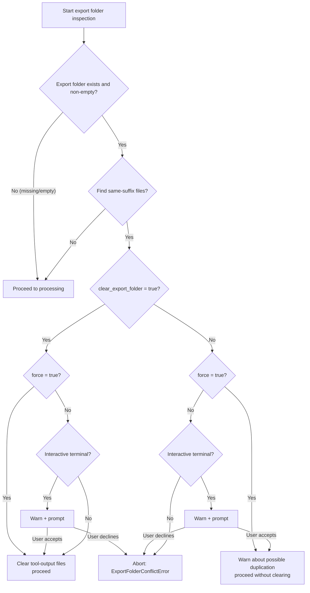

# 06 — Export Folder Cleanup Flags (`clear_export_folder` / `force`)

- **Status:** ✅ Research complete. Product Owner decisions confirmed (Q1–Q5). Specification ready for implementation.
- **Date:** 2026-10-29
- **PO decisions confirmed:** 2026-10-29 (Q1=(a), Q2=(a), Q3=(a), Q4=retracted, Q5=(a))
- **Source request:** `.ai/problems/Prob_01` (Russian, translated and formalized)
- **Related specs:** `05_dictionary_path_override_spec.md` (threading pattern for per-call overrides)

---

## 1. Problem Statement

The tool's output directory (`clean_data` / `export_folder`) is never cleaned
between runs. Because output filenames include a run timestamp
(`<table_name>_<YYYYMMDD-HHMMSS>_<N><export_suffix>`, where
`<export_suffix>` is derived from `export_settings.to_csv.compression` via
`CSVWorker.get_files_suffix()` — e.g. `.csv.gz` when compression is `"gzip"`),
each run creates new files alongside
any files left by previous runs. When a run is interrupted or when the user
re-runs after fixing the dictionary, stale output files accumulate silently,
creating confusion about which files reflect the latest data.

The Product Owner requests two configurable boolean flags:

| Flag | Default | Purpose |
|---|---|---|
| `clear_export_folder` | `false` | Whether to delete existing export files before a new run writes its output. |
| `force` | `false` | Whether to skip interactive confirmation prompts. |

Both flags must be configurable via three channels:

1. **`app_config.json5`** — persistent defaults (shipped template + user copy).
2. **CLI** — `mko-data-cleaner run <report> --clear-export-folder --force` overrides config.
3. **Python API** — `process_data(report, clear_export_folder=True, force=True)` overrides config.

The four-scenario truth table (from `Prob_01`) defines all combinations. There
is no separate `data_base` pre-check (PO retracted this on 2026-10-29).

---

## 2. Confirmed Requirements

| # | Requirement | Basis |
|---|---|---|
| R1 | `clear_export_folder` flag, default `false`, configurable via config + CLI + Python API | Prob_01 §1, §2 (all four scenarios) |
| R2 | `force` flag, default `false`, configurable via config + CLI + Python API | Prob_01 §1, §2 |
| R3 | Both flags are top-level keys in `app_config.json5` and top-level fields on `DataSettings` | PO decision Q1=(a) |
| R4 | When `clear_export_folder=true`, only the tool's own output files are deleted: files matching `<table_name>_*.<export_suffix>` in the export folder, where `<table_name>` comes from `database_settings.table_name` and `<export_suffix>` is derived from `export_settings.to_csv.compression` via `CSVWorker.get_files_suffix()` (e.g. `.csv.gz` when compression is `"gzip"`) | PO decision Q2=(a) |
| R5 | The duplicate-file warning checks for files matching `*<export_suffix>` — the full export suffix derived from `export_settings.to_csv.compression` via `CSVWorker.get_files_suffix()` (e.g. `.csv.gz` when compression is `"gzip"`). This is never hardcoded — it always reflects the current compression setting | PO decision Q3=(a) |
| R6 | The four-scenario truth table applies to **both CLI and Python API** uniformly | PO decision Q4 (retracted non-CLI divergence) |
| R7 | In Python API, `clear_export_folder=true` auto-clears without prompting | PO decision Q5=(a) |
| R8 | If the user declines confirmation (CLI interactive, scenario 2/4), the run aborts: no cleanup, no processing | Prob_01 §4 rule 4 |
| R9 | If the export folder is missing or empty, no warning is shown; processing continues | Prob_01 §4 rule 5 |
| R10 | Per-call override parameters (CLI flag / Python API arg) take precedence over config-file values | Prob_01: "explicitly passing to function" and "via command line" |
| R11 | When a flag is not explicitly passed (None), the config-file value is used as the source of truth | Hybrid override pattern (cf. spec 05 `dict_path`) |

---

## 3. Conceptual Development Tasks

| # | Purpose | Expected Outcome | Dependencies |
|---|---|---|---|
| T1 | Add `clear_export_folder: bool = False` and `force: bool = False` to `DataSettings` in `models.py` | Two new Pydantic fields; defaults match Prob_01 §4 rule 6 | — |
| T2 | Add the two new keys to the `app_config.json5` settings template | Shipped template includes `"clear_export_folder": false, "force": false` as top-level keys | T1 (field names must match) |
| T3 | Add override parameters to `process_data()`, `get_app_service()`, and `AppService.__init__()` | `clear_export_folder: bool | None = None` and `force: bool | None = None` threaded from API entry point to service construction | T1 (model already has config-level fields for fallback) |
| T4 | Add CLI Typer options `--clear-export-folder/--no-clear-export-folder` and `--force/--no-force` to the `run` command | `mko-data-cleaner run <report> [--clear-export-folder] [--force]` accepted; `None` when not specified (falls back to config) | T2 |
| T5 | Add resolution methods on `AppService` that resolve per-call override (`None` → config value) | `_resolved_clear_export_folder() -> bool` and `_resolved_force() -> bool` return the effective value | T3 |
| T6 | Implement the pre-run export-folder inspection as a private method `_handle_export_folder()` on `AppService`, called from `run_report()` between `ensure_dir(self.export_path)` (line 136) and CSVWorker creation (line 143) | The four-scenario truth table is enacted: warn, prompt (if interactive), clear (by pattern), or abort | T1, T3, T5, research §C (file naming), research §E (prompt patterns) |
| T7 | Add error class for user-declined / non-interactive abort | New exception in `errors.py` (e.g., `ExportFolderConflictError`) that propagates through CLI `except Exception` handler | T6 |
| T8 | Update test mock signature and add tests for all scenarios | Existing `test_process_data_returns_report_result` mock updated; new tests cover all four truth-table cells + CLI flags + API overrides + non-interactive abort + empty/missing folder | T1, T3, T4, T6, T7 |
| T9 | Update documentation (README, `current-behavior.md`, `architecture.md`) | Users can configure flags via all three channels; behavior table documented | T2, T4 |

---

## 4. Product Owner Decisions

### Q1 — Config placement → **(a)** Top-level keys in `DataSettings`

Both flags are top-level keys in `app_config.json5`, siblings of `data_paths`,
`data_file_settings`, `dict_file_settings`, etc. They are top-level fields on
`DataSettings` in `models.py`.

### Q2 — Clear scope → **(a)** Only tool's own output files

When `clear_export_folder=true`, the tool deletes only files matching
`<table_name>_*.<export_suffix>` inside the export folder — never all files, never all
files with the export extension. The table name comes from
`app_config.database_settings.table_name`; the suffix is **derived from**
`export_settings.to_csv.compression` via `CSVWorker.get_files_suffix()`
(never hardcoded — e.g. `.csv.gz` when compression is `"gzip"`).

### Q3 — Extension detection → **(a)** Full export suffix

The duplicate-file detection (the warning that fires when `clear_export_folder=false`)
checks for any file whose suffix matches `*<export_suffix>` — the full export suffix
**derived from** `export_settings.to_csv.compression` via
`CSVWorker.get_files_suffix()` (e.g. `.csv.gz` when compression is `"gzip"`).
This is never hardcoded: `.gz` alone would be too broad; the full
`<export_suffix>` is always used.

### Q4 — `data_base` check → Retracted

> "I mistakenly described different behavior. I removed this from the assignment."

The non-CLI-specific `data_base` check (error + stop if `data_base/` has files)
is **not** part of this feature. Both CLI and Python API follow the same
four-scenario truth table for the export folder only. The existing
`DBWorker._delete_base_files()` cleanup at run end is unchanged.

### Q5 — Python API `clear_export_folder=true` → **(a)** Auto-clear without prompting

When `clear_export_folder=true` is explicitly set (via config, CLI, or Python API),
the tool auto-clears matching files without prompting. This is the only
practical behavior for non-interactive pipeline contexts. The `force` parameter
exists for API parity but is effectively always `True` in the Python API context
(no prompts can be shown).

### Q6 — CLI flag naming for `force` → **(a)** Reuse `--force` (pending confirmation)

| Option | Verdict |
|---|---|
| **(a)** Reuse `--force` on `run` (consistent with `init --force`, different context) | **Recommended — pending PO confirmation** |
| (b) Rename to `--yes` / `--non-interactive` on `run` | Not recommended — `--force` is more conventional |
| (c) Rename `init`'s flag to `--overwrite` | Not recommended — unnecessary breaking CLI change |

---

## 5. Behavior Specification

### 5.1 Override resolution

```
effective_value = per_call_override  if per_call_override is not None  else config_value
```

- **CLI**: `--clear-export-folder` / `--no-clear-export-folder` → `True` / `False` / `None` (not specified).
- **Python API**: `process_data(..., clear_export_folder=True)` → `True`; not specified → `None`.
- **Config**: `app_config.json5` → `clear_export_folder: false` / `force: false`.

When the override is `None`, the config value is used. When the override is
explicitly `True` or `False`, it takes precedence.

### 5.2 The four scenarios

| Scenario | `clear_export_folder` | `force` | CLI (interactive terminal) | CLI (non-interactive / piped) | Python API |
|---|---|---|---|---|---|
| **1** | `false` | `false` | Warn about same-suffix files; **prompt**. Accept → proceed without clearing. Decline → **abort**. | Warn about same-suffix files; **abort** (user must set `force=true` or `clear_export_folder=true`). | Warn about same-suffix files; proceed without clearing. |
| **2** | `true` | `false` | Warn about upcoming deletion; **prompt**. Accept → clear + proceed. Decline → **abort**. | Clear + proceed (clear is explicit; no prompt possible). | Clear + proceed (Q5). |
| **3** | `false` | `true` | Warn about possible duplication; proceed without clearing; **no prompt**. | Warn; proceed without clearing. | Warn; proceed without clearing. |
| **4** | `true` | `true` | Clear (after brief warn); proceed; **no prompt**. | Clear; proceed. | Clear; proceed. |

### 5.3 Detection logic

Two checks run before processing (after `ensure_dir(export_path)`, before
CSVWorker creation at `run_report` line 136–143):

1. **Empty/missing folder check**: If the export folder does not exist or is
   empty, skip all checks and proceed (Prob_01 §4 rule 5).

2. **Same-extension file detection**: Scan the export folder for files matching
   `*<export_suffix>` — where `<export_suffix>` is **derived from**
   `export_settings.to_csv.compression` via `CSVWorker.get_files_suffix()`
   (e.g. `*.csv.gz` when compression is `"gzip"`). This check is never
   hardcoded to any specific suffix; it always reflects the current compression
   setting.

3. **Clear pattern**: When clearing is triggered, delete files matching
   `<table_name>_*.<export_suffix>` — where `<table_name>` comes from
   `database_settings.table_name` (not a literal string) and `<export_suffix>`
   is **derived from** `export_settings.to_csv.compression` via
   `CSVWorker.get_files_suffix()` (e.g. `data_table_*.csv.gz` when the table
   name is `data_table` and compression is `"gzip"`). Neither the table name
   nor the suffix is ever hardcoded.

### 5.4 Decision flow diagram



### 5.5 Interactive detection

- `sys.stdout.isatty()` returns `True` only for a real terminal.
- `'_ipykernel' / 'ipykernel' in sys.modules` — Jupyter kernel check (cf.
  `app.py` lines 17–24 import-time guard).
- In `CliRunner` tests (which capture stdout), `isatty()` returns `False` →
  non-interactive behavior applies.

### 5.6 Warnings and messages

- **Warning (same-extension files found, no clearing):** "The export folder
   contains N file(s) with the same output extension (<export_suffix>, derived
   from compression setting). Processing will
  continue without clearing. This may lead to data duplication."
- **Warn + delete (clearing):** "The export folder contains N file(s) matching
  the output pattern. They will be deleted in accordance with the
  `clear_export_folder` setting."
- **Abort:** "Processing cancelled by user." or "Cannot prompt in
  non-interactive context. Set `clear_export_folder=true` or `force=true` in
  your config to proceed."

All messages must be English (house rule: "English Only").

---

## 6. Research Summary

### 6.1 Config model integration (research §A)

`DataSettings` (models.py:170-176) maps 1:1 to top-level keys in
`app_config.json5` via `DataSettings(**config_data)` in
`AppService.app_config` (app_service.py:52-58). Adding `clear_export_folder`
and `force` as declared fields requires no additional wiring — they are
accessible as `self.app_config.clear_export_folder` and
`self.app_config.force`.

The template at `src/mko_data_cleaner/settings/app_config.json5` must be
updated to ship the new keys. The template has no
`model_config = ConfigDict(extra=...)` on `DataSettings` — Pydantic v2 defaults
to `extra="ignore"`, so unknown keys are silently swallowed. Explicit fields
are required.

**No `clear_export_folder` or `force` fields exist anywhere** (grep confirmed
zero matches across all `.py` and `.json5` files).

### 6.2 Pre-run insertion point (research §B)

Optimal insertion point: between `run_report` line 136
(`self.resolver.ensure_dir(self.export_path)`) and line 138 (CSVWorker
creation). At this point `base_path` is resolved, `export_path` exists, and
`app_config` is accessible (loaded lazily on first access).

### 6.3 File naming and pattern (research §C)

- Clean data export: `export_sql_to_csv(db_con, data_table, export_path, ...)`
  — no `file_prefix` passed, so `file_prefix` defaults to `data_table`
  (the `database_settings.table_name` value).
- File name format: `<table_name>_<timestamp>_<N><export_suffix>` where
  `<export_suffix>` is **derived from** `export_settings.to_csv.compression`
  via `CSVWorker.get_files_suffix()` (e.g. `.csv.gz` when compression is
  `"gzip"`) — never hardcoded.
- Null data export: `file_prefix="null_data"`, `export_path=base_path` (report
  root, NOT the export/clean_data folder). Null data files are **outside the
  scope** of `clear_export_folder`.
- `CSVWorker.get_files_suffix()` is the single source of truth for
  `<export_suffix>`: maps compression to `.csv.gz` (gzip), `.csv` (no
  compression), `.csv.bz2`, `.csv.xz`, `.csv.zip`, `.csv.zst` — always
  derived, never hardcoded in the cleanup logic.
- Clearing glob pattern: `<table_name>*.<export_suffix>` (e.g.
  `data_table*.csv.gz` when table name is `data_table` and compression is
  `"gzip"`).
- Extension warning glob pattern: `*<export_suffix>` (e.g. `*.csv.gz`).

**Important subtlety**: Python's `Path.suffix` returns only the last extension
(`.gz` for `file.csv.gz`). Must use `endswith()` or
`glob("*" + <export_suffix>)` to match the full derived suffix — e.g.
`.csv.gz`, never just `.gz`.

### 6.4 CLI/API threading (research §D)

The `dict_path` override (spec 05) established the threading pattern:
`process_data(dict_path=...)` → `get_app_service(dict_path=...)` →
`AppService.__init__(dict_path=...)` → stored as `self._dict_path` → resolved
in the `dict_path` property.

The same pattern applies to `clear_export_folder` and `force`:
- `process_data(clear_export_folder=None, force=None)` →
  `get_app_service(clear_export_folder=None, force=None)` →
  `AppService.__init__(clear_export_folder=None, force=None)` →
  `self._clear_export_folder`, `self._force` → resolved in
  `_resolved_clear_export_folder()` / `_resolved_force()`.

The existing test mock at `test_app.py:311-313` will need updating:
```python
# Before:
lambda settings_dir=None, dict_path=None: fake_service
# After:
lambda settings_dir=None, dict_path=None, clear_export_folder=None, force=None: fake_service
```

### 6.5 Interactive prompts (research §E)

- `rich.prompt.Confirm` — not currently imported but `rich` is already a
  dependency (declared in `pyproject.toml:28`, imported via `Console` in
  `app.py:10`).
- `typer.confirm()` — Typer is already a dependency; not currently used.
- `sys.stdout.isatty()` — standard terminal detection; returns `False` in
  `CliRunner` tests (captured stdout) and Jupyter kernels.
- `'ipykernel' in sys.modules` — Jupyter kernel detection (cf. `app.py:17-24`
  import-time guard pattern).

**Recommended**: Use `typer.confirm()` for the prompt, guarded by
`sys.stdout.isatty()` + ipykernel check. In non-interactive contexts, skip the
prompt and apply the "non-interactive" column of the truth table (scenario 1/4
→ abort; scenario 2/3 → proceed).

### 6.6 Test patterns (research §F)

- `populated_settings` fixture (test_app.py:33-41) copies templates from
  `TEMPLATE_SETTINGS_DIR` → new `app_config.json5` keys propagate automatically
  with their default `false` values.
- `synthetic_report` fixture (conftest.py:90-127) creates a fresh `tmp_path`
  report directory per test → no cross-test contamination.
- `CliRunner` captures stdout → `isatty()` returns `False` → non-interactive
  path in tests. For interactive prompt tests, use `monkeypatch` to force
  `isatty` to `True` and `input()` to return the desired answer.

### 6.7 Existing cleanup logic (research §G)

`DBWorker._delete_base_files()` (db_service.py:827-828) uses
`self.db_file.parent.glob(self.db_file.name + "*")` to delete SQLite files
(`db_example.db`, `db_example.db-wal`, `db_example.db-shm`). This is
**DB-file cleanup, not export-folder cleanup** — unrelated to the new feature
but follows the same glob-based deletion pattern.

---

## 7. Assumptions

| # | Assumption | Basis | Risk if wrong |
|---|---|---|---|
| A1 | The term "export_folder" in the request == `clean_data` directory (from `data_paths.export_folder` in config) | Config + field name alignment | If it refers to something else, the wrong directory gets cleaned |
| A2 | The term "data_base" in the retracted section was the `data_base/db_example.db` directory — now removed from scope | PO retraction Q4 | None (scope removed) |
| A3 | The export file prefix is always `<table_name>` (i.e., `data_table`), derived from `database_settings.table_name` | research §C: no explicit `file_prefix` in `export_sql_to_csv` call → falls back to `data_tbl_name` | If a future change adds a `file_prefix`, the clear pattern must be updated |
| A4 | `force` on the `run` CLI command reuses the `--force` name already on `init` (different context, same convention) | Q6 recommendation (a), pending confirmation | If PO selects (b), CLI flag name changes but implementation approach is unchanged |
| A5 | In Python API, `force` is effectively a no-op (no prompts exist); it exists for API surface parity only | Q5 PO statement: "force parameter exists for API parity but is effectively always True" | If PO later wants `force` to control non-interactive abort behavior, the truth table needs updating |
| A6 | The non-interactive abort for scenario 1 (clear=F, force=F) is safe and desired | Researcher recommendation; common practice for CLI tools | Could break existing automated workflows that have stale files; mitigated by clear error message with remediation steps |
| A7 | `CSVWorker.get_files_suffix()` is the single source of truth for the export suffix | Code-verified: csv_service.py:267-288 | If the export path bypasses this method, the suffix detection must be reconciled |
| A8 | The truth table applies uniformly — there is no Python-API-specific "warn and continue without prompt" mode distinct from CLI non-interactive mode | Q4: "uniformly" | If PO later wants Python API to silently continue (no abort) in scenario 1, the non-interactive column changes |

---

## 8. Constraints

- **English-only messages**: All user-facing strings (warnings, errors, logs)
  must be in English (house rule: "English Only", project.md §1). The current
  codebase has Russian run messages (D-5 gap) — this feature's messages must be
  English and can serve as a model.
- **Pydantic v2**: `clear_export_folder` and `force` are `bool` fields with
  `False` defaults. No `StrEnum` needed (booleans, not fixed-value strings).
- **No `print()` in production code**: Use `logger` for log messages. For
  user-visible console output, use `rich.console.Console` (already imported in
  `app.py`) or `typer.echo()`.
- **No changes to `csv_service.py` or `db_service.py`**: The file-detection
  and deletion logic lives in `app_service.py` (orchestration layer).
- **`run_report()` signature unchanged**: Following spec 05's Approach B, the
  override is injected at `get_app_service()` → `AppService.__init__()` and
  resolved internally. `run_report(data_path)` keeps its current signature.
- **Backward compatible**: When both flags are `None` (not provided), config
  values (`false` by default) apply, and the tool behaves exactly as today —
  it creates the export dir if missing and writes new timestamped files
  alongside any existing ones.
- **No migration needed**: New config keys default to `false`. Existing
  user configs (missing the keys) work because `DataSettings` provides
  `False` defaults. No `init --force` required.

---

## 9. Risks

| # | Risk | Impact | Mitigation |
|---|---|---|---|
| R1 | **Accidental data loss from pattern mismatch** | If the clear glob pattern is too broad, user files in `clean_data/` could be deleted | Scope strictly to `<table_name>_*.<export_suffix>` (not `*<export_suffix>`); log each deleted file path; require `clear_export_folder=true` explicitly (not just `force=true`) |
| R2 | **Pattern mismatch for non-default `table_name`** | If a user changes `database_settings.table_name`, the clear pattern must follow | Derive pattern dynamically from `app_config.database_settings.table_name`, not hard-coded |
| R3 | **Suffix mismatch for non-gzip compression** | If user changes `export_settings.to_csv.compression`, the suffix detection must follow | Use `CSVWorker.get_files_suffix()` as the single source of truth (R7) |
| R4 | **Non-interactive abort breaks CI/automated workflows** | Scenario 1 (both flags false) in non-interactive context aborts — any automated rerun with stale export files now fails | Error message must include remediation: "Set `force=true` or `clear_export_folder=true` in app_config.json5" |
| R5 | **`--force` naming conflict with `init --force`** | Users may confuse "skip prompt" with "overwrite settings" | Q6=(a) recommended; help text must clearly state `--force` skips confirmation on `run`. Track Q6 as pending PO confirmation |
| R6 | **Test mock signature drift** | Adding `clear_export_folder`/`force` to `get_app_service()` breaks the `test_process_data_returns_report_result` mock lambda | Update mock to `lambda settings_dir=None, dict_path=None, clear_export_folder=None, force=None: fake_service` (spec 05 precedent) |
| R7 | **Jupyter kernel: `isatty()` returns True** | Some Jupyter environments report `isatty()==True` for `sys.stdout`, causing the tool to attempt an interactive prompt that blocks | Guard with `'ipykernel' in sys.modules` check; if in kernel, treat as non-interactive |
| R8 | **Existing `clean_data/` has user-placed files** | If a user manually copies files into `clean_data/` that don't match `<table_name>_*.<export_suffix>`, they won't be cleared — potential confusion | Only `<table_name>_*.<export_suffix>` files are cleared; user files are preserved. Warning message should clarify "only tool-generated files are affected" |

---

## 10. Out of Scope

- **No `data_base/` folder check** — PO retracted this (Q4). The existing
  `DBWorker._delete_base_files()` at run end is unchanged.
- **No folder-merge fallback changes** — `CSVWorker.get_merged_dictionary()` is
  untouched.
- **No changes to `dict_service.py`, `db_service.py`, `csv_service.py`,
  `paths.py`, or `init_service.py`** — all changes are confined to `app.py`,
  `app_service.py`, `models.py`, `settings/app_config.json5`, `errors.py`, and
  documentation.
- **No changes to `ReportResult`** — the two new flags are inputs, not outputs.
  They are not added to `ReportResult` (per spec 05 Q4 precedent).
- **No GUI/web changes** — flags are config + CLI + Python API only.
- **No changes to the rule engine** — DELETE → REPLACE → ADD order is unchanged.
- **No internationalization (i18n) framework** — all new messages are English
  only (house rule). Full i18n is tracked as OQ-10 in `open-questions.md`.

---

## 11. Definition of Ready

All items below must be satisfied before implementation begins:

1. ✅ **PO decisions confirmed**: Q1=(a) config placement, Q2=(a) clear scope,
   Q3=(a) extension suffix, Q4 retracted, Q5=(a) Python API auto-clear.
2. ✅ **Q6 pending**: `--force` CLI flag naming — recommended (a) reuse `--force`;
   if (b) is chosen, only the flag name in T4/T8 changes.
3. ✅ **Implementation approach selected**: Hybrid config-level defaults +
   per-call override parameters, threaded via `get_app_service()` →
   `AppService.__init__()` (same pattern as `dict_path` in spec 05).
4. ✅ **Acceptance criteria defined**:
   - `app_config.json5` contains `clear_export_folder: false` and `force: false`
     as top-level keys.
   - `DataSettings` has `clear_export_folder: bool = False` and `force: bool = False`.
    - `mko-data-cleaner run <report> --clear-export-folder --force` clears
      `<table_name>_*.<export_suffix>` files from `clean_data/` before processing
      (where `<export_suffix>` is derived from `export_settings.to_csv.compression`).
   - `process_data(report, clear_export_folder=True, force=True)` does the same
     in Python API.
   - Without any flags, behavior is byte-for-byte identical to today (warn-only
     if interactive, abort if non-interactive with stale files).
   - Declining a prompt aborts the run (no cleanup, no processing).
   - Missing or empty export folder → no warning, proceed normally.
5. ✅ **Test plan defined**: All four truth-table scenarios + override precedence
   (None → config, explicit → override) + CLI flag + Python API param +
   non-interactive abort + empty/missing folder + table_name/compression
   variations.
 6. ✅ **File naming verified**: Clear pattern is `<table_name>_*.<export_suffix>`;
    warning detects `*<export_suffix>`; **both derived from config**
    (`database_settings.table_name` and `export_settings.to_csv.compression`
    via `CSVWorker.get_files_suffix()`) — never hardcoded.
7. ✅ **Risk R7 mitigated**: Jupyter detection via `'ipykernel' in sys.modules`
   guard on top of `isatty()`.
8. ✅ **Risk R6 mitigated**: Test mock lambda updated (spec 05 precedent).

---

## 12. Implementation Pathway (Reference)

Derived from research §D/E and spec 05's threading pattern. This section is
for implementer orientation only — it describes the "how" lightly; the "what"
is fully defined in §5.

```
CLI run --clear-export-folder --force <report>
  → app.py: run(report, …, force=None, clear_export_folder=None)
  → get_app_service(settings_dir, dict_path, force, clear_export_folder)
  → AppService.__init__(…, force=None, clear_export_folder=None)
  → run_report(data_path):
      1. self.base_path = data_path            # line 125
      2. self.resolver.ensure_file_parent(db)  # line 135
      3. self.resolver.ensure_dir(export)      # line 136
      4. NEW: self._handle_export_folder()     # ← INSERT HERE (between 136 and 138)
      5. CSVWorker(...)                         # line 143
      …
```

Resolution helper on `AppService`:
```python
def _resolved(self, attr: bool | None) -> bool:
    return attr if attr is not None else getattr(self.app_config, ...)
```

---

## 13. Related Docs

- [Prob_01 — original Russian request (source)](../../.ai/problems/Prob_01)
- [Spec 05 — Dictionary Path Override (threading pattern reference)](../../.ai/problems/05_dictionary_path_override_spec.md)
- [current-behavior.md — pre-run flow, error handling, existing cleanup](docs/00-overview/current-behavior.md)
- [architecture.md — component responsibilities, DataSettings model)](docs/00-overview/architecture.md)
- [open-questions.md — D-5 Russian messages gap, OQ-10 i18n](docs/00-overview/open-questions.md)
