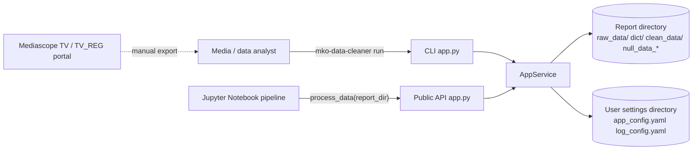
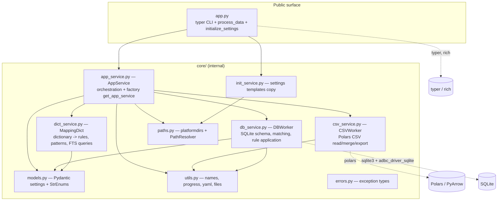
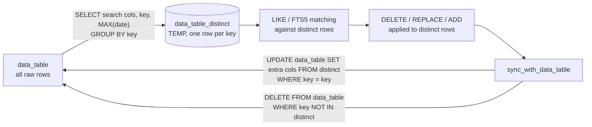
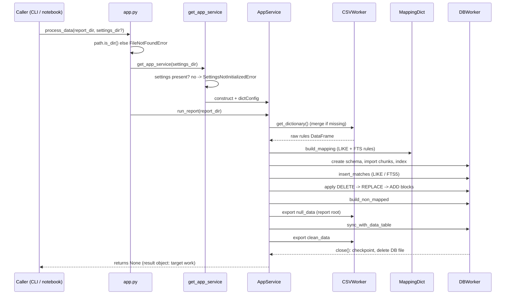

## Purpose

Describe the technical architecture: the system context, the main components
and their responsibilities, how they interact, the public interfaces, the
SQLite schema used as the processing engine, and the significant technical
risks and trade-offs. This is intentionally not an exhaustive file listing;
the goal is that a new developer can orient without reading the whole
repository.

## System Context

External systems: none. The only external inputs are files on disk; the only
external actor is the analyst (or, in the target usage, a Notebook pipeline
kernel). The upstream Mediascope portal is out of scope — exports arrive
manually.

## Component Overview

Call direction is strictly `app.py → core/*`; no core module imports `app.py`
[code-verified].

## Component Responsibilities

| Component | Responsibility | Key public functions |
|---|---|---|
| `app.py` | CLI commands (`init`, `run`, `list-settings`) and the two-function Python API; user-facing messages | `process_data`, `initialize_settings`, `run`, `init`, `list_settings` |
| `core/app_service.py` | Orchestrates a full report run; lazy service factory with the settings gate; path properties (import/export/dict/db) | `AppService.run_report`, `get_app_service`, `build_app_paths`, `_require_settings` |
| `core/csv_service.py` | All Polars I/O: header detection, streaming chunked import, dictionary read/merge, SQLite→CSV export | `CSVWorker` |
| `core/dict_service.py` | Turns the dictionary into executable rule sets: LIKE patterns, FTS queries, per-action blocks, search-column bookkeeping | `MappingDict` |
| `core/db_service.py` | SQLite schema and all rule execution: table creation, indexing, match computation (LIKE + FTS5), DELETE/REPLACE/ADD application, non-mapped extraction, synchronization, cleanup | `DBWorker` |
| `core/models.py` | Pydantic v2 configuration models and `StrEnum` constants (`ActionType`, `MatchType`, `MappingColumns`) | — |
| `core/paths.py` | Settings/report path resolution (`platformdirs`), directory/file helpers | `PathResolver`, `AppPaths`, `APP_PATHS` |
| `core/utils.py` | SQL-identifier hygiene, YAML loading, file listing, progress bar | — |
| `core/errors.py` | Exception hierarchy (`WrongDataSettings`, `ConfigError`, `SettingsNotInitializedError`, …) | — |
| `core/init_service.py` | Copies the packaged YAML templates into the user settings directory | `init_project` |

## Per-Key Rule Resolution (intended design, owner decision D15)

When `index_column` (the unique advertisement key, e.g. `AdId`) is
configured — the default — the tool resolves rules **once per unique key**
instead of once per row. This is a deliberate performance optimization
(owner-confirmed), and the mechanics are:

Verified details ([code](../../src/mko_data_cleaner/core/db_service.py) +
[runtime]):

- **Representative row:** the `GROUP BY` with `MAX(date)` makes SQLite take
  the bare (search) column values from the row that holds the maximum date —
  the latest row per key. Without a configured date column the values come
  from an arbitrary row of the group.
- **Extra columns** exist in the distinct table but start as `NULL`; only the
  rules fill them.
- **Join back:** `UPDATE data_table … FROM distinct … WHERE key = key` copies
  the resolved extra columns to *all* data rows sharing the key, and
  `DELETE FROM data_table WHERE key NOT IN (SELECT key FROM distinct)` removes
  every data row whose key was deleted by a DELETE rule.
- **Consequence:** rows that share a key but differ in a searched column get
  the same cleaning decision (that of the representative row).
- **Defensive branch:** the INSERT part of `_sync_tables` (key present in the
  distinct table but missing from the data table) cannot fire in the standard
  flow, because the distinct table is built from the data table.
- When `index_column` is **not** configured, no distinct table is created and
  rules are applied directly per row in `data_table`.

The database is created per run and deleted afterwards. Two connections are
used: `sqlite3` for DDL and queries, ADBC for bulk writes.

| Object | Created by | Purpose |
|---|---|---|
| `data_table` | `create_table_with_index` | All imported rows, all columns `TEXT` |
| `{data_table}_distinct` (TEMP) | `_create_index_table` | One row per `index_column` value: search + extra columns + index + `MAX(date)`; the **target** of rule application when an index column is configured (intended per-key resolution — see "Per-Key Rule Resolution") |
| `{target}_fts` (FTS5 virtual) | `link_search_table` | Full-text index over the distinct table, kept in sync by insert/update/delete triggers |
| `full_matches_table` (TEMP) | `create_rules_matches` | (data_rowid, mapping_index) match pairs, indexed |
| `mapping_table`, `temp_tbl`, `fts_temp_tbl` | `run_report` | Per-block rule uploads used for joining |
| `joined_matches_table` (TEMP) | `_build_joined_matches` | Matches joined with the current rule block |
| `data_table_tags` (TEMP) | `_ensure_tags_table` | (rowid, column_name, value) tag accumulator for ADD, unique index |
| `non_mapped` (TEMP) | `build_non_mapped` | Rows with any NULL extra column |

Performance pragmas are tuned for bulk processing
(`journal_mode=WAL`, `synchronous=OFF`, `temp_store=MEMORY`,
`cache_size=-100000`) — acceptable because the database is disposable, but
`synchronous=OFF` trades durability for speed ([`_init_base`](../../src/mko_data_cleaner/core/db_service.py)).

## Public Interfaces vs. Internal Details

- **Public, documented:** `process_data(report_path, settings_dir=None)` and
  `initialize_settings(force=False, settings_dir=None)`
  ([app.py](../../src/mko_data_cleaner/app.py)), plus the CLI commands.
- **Not part of the contract:** everything under `mko_data_cleaner.core.*`.
  The README still shows the old `core.app_service.app_service` import, which
  no longer exists (the singleton was replaced by the `get_app_service`
  factory) — documented as discrepancy D-3 in
  [open-questions.md](open-questions.md).
- `src/mko_data_cleaner/__init__.py` is currently **empty**, so
  `from mko_data_cleaner import process_data` fails; top-level re-exports are
  owner-confirmed target work (R4) [code-verified].

## Configuration and External Dependencies

Runtime dependencies ([pyproject.toml](../../pyproject.toml)):

| Package | Used for |
|---|---|
| `polars`, `pyarrow` | CSV reading/writing, in-memory rule DataFrames |
| `adbc-driver-sqlite` | Fast bulk writes into SQLite |
| `typer` | CLI framework |
| `rich` | Console output (**imported but not declared** — D-5) |
| `pydantic`, `pydantic-settings` (unused residue) | Settings validation and enums |
| `platformdirs` | Per-user settings directory location |
| `PyYAML` | Settings files |
| `Unidecode` | Transliteration of column names |
| `pandas` | Legacy (only referenced by unused DB constants) |

Configuration files: `app_config.yaml` (paths, extensions, index/date columns,
dictionary column indexes, separators, CSV reader/writer options) and
`log_config.yaml` (logging). See
[current-behavior.md](current-behavior.md) for the key-by-key effects.

## Key Scenario: `process_data(report_dir)`

Error path: if settings are missing the sequence stops at the factory with
`SettingsNotInitializedError` before any file is touched; the CLI renders it
as `❌ Ошибка: …` and exits with code 1.

## Error Handling and Significant Side Effects

- All destructive or filesystem work happens inside `run_report`; nothing
  happens at import time (settings gate + lazy factory).
- `DBWorker` is a context manager: on any exception the connections are
  closed, the WAL is checkpointed and the database file is deleted.
- The DB file lives **inside the report directory** by default
  (`data_base/db_example.db`), so a run needs write access to the report
  folder.
- Console progress uses a custom `print("\r…")` progress bar
  ([utils.py `progress_bar`](../../src/mko_data_cleaner/core/utils.py)); logs
  go to `log.log` in the user settings directory and to stdout.
- User-visible run messages in `run_report` are still in Russian
  (`Обработка стартовала …`), while the newer CLI messages are English —
  see D-5 in [open-questions.md](open-questions.md).

## Technical Risks and Trade-offs

| # | Item | Impact | Status |
|---|---|---|---|
| 1 | Rules are applied to the **distinct index table** and synchronized back — values are resolved per `index_column` value, not per row | **Intended design (D15):** a deliberate performance optimization; representative row = latest date per key | Documented as intended behavior |
| 2 | ADD writes the merged tag list into the extra column instead of merging with a value previously written by REPLACE | Owner-confirmed intent (D13): REPLACE-then-ADD → `1 2` (merged); current implementation yields `2` (only ADD tags). ADD-on-ADD merging works as documented | **Confirmed gap (D-2)**, not fixed |
| 3 | `synchronous=OFF` + disposable DB | Fast, but a crash mid-run loses the in-progress DB (acceptable by design) | Accepted trade-off |
| 4 | Dictionary schema is positional (`col_indexes`); with the shipped config the term sits at index 4 and column 3 is unused | Users must align their dictionary with the config (README now documents the `term: 3` alternative) | Resolved in docs (D12) |
| 5 | `rich` imported but undeclared; license metadata (MIT classifier) contradicts the BSD-3-Clause LICENSE; no `__version__`; empty top-level `__init__.py` | Publishing/install risk | Owner-confirmed target fixes (D4, R9), detailed in open-questions D-8 |
| 6 | No CI, no git tags, no example notebook yet | Reproducibility depends on the developer machine | Owner-confirmed target work (D9–D11) |
| 7 | README documents the removed `core.app_service.app_service` singleton | Users following the README hit an `ImportError` | **Resolved** — README section removed (D-3) |
| 8 | Duplicate execution of the DELETE statement in `_apply_delete` | Harmless (second pass matches nothing) but wasteful | Defect noted; full description in [`01-apply-delete-double-execution.md`](../../.ai/audit/problems/01-apply-delete-double-execution.md); **not fixed** (task forbids code changes) |

## Related Docs

- [current-behavior.md](current-behavior.md) — runtime behavior with evidence
- [data-flow.md](data-flow.md) — data formats and transformations
- [product-overview.md](product-overview.md) — product intent and target state
- [open-questions.md](open-questions.md) — decisions, gaps, open questions
