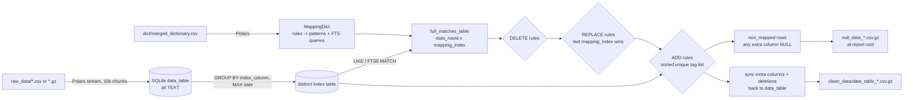

## Purpose

Document where data comes from, what happens to it, in which order, and what
comes out — formats, field meanings, and the handling of missing, duplicate,
unknown and invalid values. Business meaning is only stated where the code,
tests, README or the owner's recorded decisions establish it; everything else
is labeled as an assumption or an open question. For the runtime walk-through
see [current-behavior.md](current-behavior.md).

## Data Sources and Provenance

| Input | Format | Provenance |
|---|---|---|
| Raw Mediascope export files | `.csv` (or `.gz`), `;`-separated, upper-case values, first row = headers | Downloaded manually from Mediascope (TV / TV_REG reports) — the tool never contacts Mediascope |
| Dictionary | `.csv`, `;`-separated; column **positions** (not names) carry the meaning, configured via `col_indexes` | Maintained by the analyst; may be produced by merging several dictionary files |
| Settings | `app_config.yaml` + `log_config.yaml` per user (packaged templates, edited after `init`) | Shipped inside the package |

Original files are never modified: the tool only reads `raw_data/` and the
dictionary, and writes new files (`clean_data/`, `null_data_*`). The SQLite
database is created per run and deleted at the end — it is a processing
engine, not a store [code-verified, runtime-verified].

## Field and Column Semantics

### Source columns

- Taken verbatim from the first raw file's header, in file order.
- Cleaned into valid SQL identifiers: transliteration (`unidecode`), removal
  of non-alphanumeric characters, de-duplication with numeric suffixes
  ([utils.py `clean_names`](../../src/mko_data_cleaner/core/utils.py)).
  The exported header uses the cleaned names, so `COST RUB` becomes `COSTRUB`
  [runtime-verified].
- Example canonical export columns (README): `YEAR;MONTH;ADVERTISERS;BRANDS;
  SUBBRANDS;ARTICLE LIST3;ARTICLE LIST4;ADID;MEDIA;COST RUB;QUANTITY`.
- Business meaning of each column comes from Mediascope, not from this tool;
  the tool treats them as opaque text values.

### Extra columns (analyst-defined outputs)

- Declared by the dictionary: every dictionary column whose index is greater
  than the highest configured `col_indexes` value becomes an extra column
  ([`_initialize_mapping`](../../src/mko_data_cleaner/core/dict_service.py)).
  With the shipped template (max configured index = 4) these are the columns
  at index 5+.
- The **column names** in the exported data are the (cleaned) dictionary
  header names, e.g. `BRAND CLEANED` → `BRANDCLEANED` [runtime-verified].
- Entirely empty dictionary columns are dropped and never exported
  [runtime-verified].

### Internal mapping columns

| Column | Meaning |
|---|---|
| `mapping_index` | Stable 1-based rule id, used for match bookkeeping and REPLACE tie-breaking |
| `column_name` | Data-table column a LIKE rule searches (resolved from the search index) |
| `pattern` | The LIKE pattern or the FTS5 query built from the rule |
| `data_rowid` | Row id of a matched row in the target table |

## Transformation Pipeline (in order)

1. **Import** — every raw file is streamed and appended to `data_table`
   (Polars → ADBC `write_database`, chunk = 10 000).
2. **Index build (per-key resolution — intended design, decision D15)** — if
   `index_column` is configured, the distinct index table
   (`data_table_distinct`, TEMP) is filled with
   `SELECT search cols, index col, MAX(date) … GROUP BY index col`: one row
   per unique key. In SQLite the bare (search) columns take their values from
   the row holding the `MAX(date)` — i.e. the latest row per key (an
   arbitrary row when no date column is configured). The extra columns are
   created but stay `NULL` until rules fill them
   ([update_index_from_data](../../src/mko_data_cleaner/core/db_service.py))
   [runtime-verified].
3. **Match computation** — for every search column, one `LIKE … COLLATE NOCASE`
   query per rule; FTS rules are matched through the FTS5 virtual table.
   Matches land in `full_matches_table` as (data_rowid, mapping_index) pairs.
   **Matching runs against the distinct index table**, i.e. once per unique
   key — the performance optimization behind this design.
4. **DELETE** — matched rows are removed from the target (distinct) table.
5. **REPLACE** — matched rows get the rule's extra-column values; the highest
   `mapping_index` per row wins.
6. **ADD** — matched rows accumulate all matching ADD values for a column into
   a de-duplicated, alphabetically sorted list; the list **replaces** the
   cell's previous content (see D-2 in [open-questions.md](open-questions.md)
   — owner-confirmed intent is a merge with the previous value).
7. **Non-mapped extraction** — distinct combinations of search + extra columns
   where any extra column is NULL.
8. **Synchronization** — the extra columns resolved per unique key are copied
   from the distinct index table back to all data rows sharing that key;
   data rows whose key was deleted are removed from `data_table`. The INSERT
   branch of `_sync_tables` is defensive and cannot fire in the standard flow
   (the distinct table is a subset of the data keys).
9. **Export** — `data_table` → `clean_data/data_table_<timestamp>_N.csv.gz`,
   values written as text; non-mapped → `null_data_<timestamp>_N.csv.gz` at
   the report root; the database is deleted.

## Validation and Business Rules Implemented in the Pipeline

| Rule | Where | Notes |
|---|---|---|
| Rule order DELETE → REPLACE → ADD | [generate_rules_blocks](../../src/mko_data_cleaner/core/dict_service.py) | Fixed; config cannot reorder |
| LIKE pattern construction (`f/p/s/e`) and upper-casing | [`_build_search_like_pattern`](../../src/mko_data_cleaner/core/dict_service.py) | |
| FTS query construction (`col:"(term)"` per index) | [build_match_query](../../src/mko_data_cleaner/core/dict_service.py) | Invalid rows skipped |
| REPLACE conflict resolution (last rule wins) | [`_apply_replace`](../../src/mko_data_cleaner/core/db_service.py) | `ORDER BY mapping_index DESC, rowid DESC` |
| ADD uniqueness + alphabetical sorting + separator | [`_apply_add`](../../src/mko_data_cleaner/core/db_service.py) | separator from `add_separator` |
| Matching only against configured search columns | [search_columns setter](../../src/mko_data_cleaner/core/db_service.py) | Names not present in the data are dropped |
| Date column detection (YYYY-MM-DD pattern, 500-row sample, 80% threshold) | [`_is_date_column`](../../src/mko_data_cleaner/core/csv_service.py) | |
| Column/table name validity for SQL | [utils.py](../../src/mko_data_cleaner/core/utils.py) | cleaning or `WrongDataSettings` |

## Handling of Missing, Duplicate, Unknown and Invalid Values

| Case | Handling | Evidence |
|---|---|---|
| Extra column stays empty after rules | Row appears in `null_data` (distinct search+extra combination) | [build_non_mapped](../../src/mko_data_cleaner/core/db_service.py) [runtime-verified] |
| All extra columns filled | No `null_data` file is produced | [runtime-verified] |
| Empty string in an extra column of the dictionary | Treated as NULL for matching/non-mapped purposes | [runtime-verified] |
| Unknown advertiser/brand (no rule matches) | Row passes through unchanged with empty extra columns and is reported in `null_data` | [runtime-verified] |
| Rule whose search column no longer exists in the export | Column name filtered out at assignment time; rule cannot match | [search_columns setter](../../src/mko_data_cleaner/core/db_service.py) |
| Several rules match the same row | DELETE: row removed; REPLACE: highest `mapping_index` wins; ADD: all values merged (de-duplicated, sorted) | [runtime-verified] |
| REPLACE and ADD write the same extra column | REPLACE runs first, then ADD — but ADD currently overwrites the REPLACE value instead of merging with it (owner-confirmed intent: `1` + `2` → `1 2`; implementation yields `2`) | [runtime-verified 2026-10-15] (D-2) |
| Missing `search_column_idx` column during dictionary merge | Merge fails with a Polars error (the column name is hard-coded in the merge step) | [get_merged_dictionary](../../src/mko_data_cleaner/core/csv_service.py) [code-verified] |
| Ragged CSV row | Polars `ComputeError` — run aborts | [runtime-verified] |
| Duplicate rows in raw data | All imported. With `index_column` configured, rule resolution happens once per unique key (representative = latest-date row) and results are distributed back to all rows with that key | [runtime-verified on dedup semantics; intended per D15] |
| Duplicate rules in the merged dictionary | Deduplicated (`unique()`) only when the merge path runs | [code-verified] |
| Invalid FTS dictionary row | Row skipped with a warning | [code-verified] |

## Outputs and Their Consumers

| Output | Consumer | Purpose |
|---|---|---|
| `clean_data/data_table_*.csv.gz` | Analyst's downstream report/pipeline | The cleaned dataset: original columns + analyst columns |
| `null_data_*.csv.gz` | The analyst (dictionary author) | Recognition gaps → dictionary improvement loop (README: "дообучение словаря") |
| `log.log` + console logs | Operator | Progress, row counts, warnings |
| `process_data` return value | Pipeline (target) | Currently `None`; owner-confirmed to become a result object with paths + timings + clean row counts (D8) |

## Provenance and Preservation of Original Values

- **Source columns** are preserved unchanged (values are re-exported as text;
  numeric formatting is governed by the CSV writer settings).
- **Extra columns** do not preserve prior content: REPLACE overwrites them,
  and ADD overwrites them with the merged tag list (D-2 open question).
- **Extra columns that no rule touches** are exported as empty values and the
  row is listed in `null_data`.
- The intermediate database is deleted after the run, so no audit trail of
  intermediate states exists.
- File names carry the run timestamp (`<prefix>_<YYYYMMDD-HHMMSS>_<N>`), so
  repeated runs never overwrite previous outputs.

## Certainty Register

| Topic | Status |
|---|---|
| Rule order, pattern building, ADD/REPLACE/DELETE mechanics | **Confirmed** — code + tests + runtime verification (ADD-on-ADD merging included) |
| REPLACE-then-ADD on one column | **Owner intent confirmed (D13): merge (`1 2`); implementation overwrites (`2`)** — gap D-2, not fixed |
| Non-mapped definition, export location and purpose | **Confirmed** — code + runtime verification + owner decision D14 (dictionary feedback only) |
| Per-key rule resolution and synchronization | **Confirmed intended design (D15)** — code + runtime verification; described in [architecture.md](architecture.md) |
| Dictionary column at index 3 unused by the shipped config | **Confirmed by code; resolved by decision D12** — README example now matches the base config |
| Business meaning of `ADID`, `MEDIA`, `QUANTITY`, article lists | **Assumption** — Mediascope semantics, not defined in this repository |
| Purpose of the `value`-style column seen in legacy example dictionaries | **Open question** (D-9) |
| Whether `date_column` should default to `MAX(date)` per key | **Open question** (OQ-7) |
